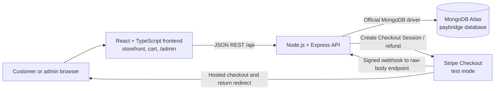

# PayBridge

PayBridge is a single-merchant commerce application that turns a product catalogue into pending orders, Stripe-hosted test payments, reconciled payment/refund records, and operational analytics. It demonstrates the integration problem behind a small commerce platform: the browser, application database, payment provider, and asynchronous webhooks must agree on an order without trusting client-supplied prices or browser redirects as payment confirmation.

MongoDB Atlas is the operational data backbone. The application stores catalogue documents, immutable order-item snapshots, payment attempts, refund records, and processed webhook metadata in the `paybridge` database. The model combines embedded purchase snapshots with separately evolving payment/refund records; indexes and aggregation pipelines support order lookup, webhook idempotency, refund reconciliation, and admin reporting.

## Table of contents

- [Implemented features](#implemented-features)
- [Screenshots](#screenshots)
- [Architecture](#architecture)
- [MongoDB Atlas in the solution](#mongodb-atlas-in-the-solution)
- [Technology stack](#technology-stack)
- [Local setup](#local-setup)
- [Vercel deployment](#vercel-deployment)
- [Developer resources](#developer-resources)
- [Example workflows](#example-workflows)
- [Known limitations](#known-limitations)

## Implemented features

- **Product catalogue:** Responsive React storefront fetches active products from the API; products are not hardcoded in the frontend.
- **Project landing page:** A public architecture overview links to the storefront and admin dashboard; the storefront remains available at `/shop`.
- **Cart and order creation:** Cart persists in browser localStorage. The backend accepts product IDs and quantities, reads current prices/stock, validates currency and availability, and creates a pending order with purchase-time snapshots.
- **Stripe sandbox payments:** Backend creates or reuses Stripe Checkout Sessions using order snapshots. Stripe secret keys remain backend-only and the client accepts standard test-mode secret keys.
- **Webhook-driven confirmation:** Raw webhook bodies are signature-verified. Payment/order state changes are based on Stripe events, not the browser return page.
- **Order and payment administration:** Protected `/admin` views provide order search/details, payment-attempt records, and processed webhook event metadata.
- **Full and partial refunds:** Admins can request a confirmed refund against an eligible paid payment. The backend validates and reserves the remaining balance, records each refund, and reconciles Stripe API responses and verified refund webhooks.
- **MongoDB-backed analytics:** Aggregations report order/payment metrics and time series, product revenue, and refund results. Monetary values remain separated by currency.
- **Admin access:** Backend-protected admin APIs use a configured account and an expiring signed bearer token.

The storefront does not reserve or decrement stock when an order is created. See [Known limitations](#known-limitations) and the [architecture documentation](docs/ARCHITECTURE.md).

## Screenshots

No screenshot assets are currently present in the repository. Capture these views manually and save them in `docs/screenshots/`; the filenames below are recommendations, not existing assets.

| View | Recommended filename |
|---|---|
| Portfolio project landing page | `project-landing.png` |
| Customer storefront | `storefront.png` |
| Shopping cart | `shopping-cart.png` |
| Stripe Checkout in test mode | `stripe-checkout-test-mode.png` |
| Admin overview | `admin-overview.png` |
| Order management and refund detail | `admin-orders-refunds.png` |
| Analytics dashboard | `admin-analytics.png` |

Use test data for screenshots and avoid capturing credentials, payment details, or customer data.

## Architecture



The React/Vite frontend provides the public project overview, customer storefront at `/shop`, checkout return pages, and protected admin dashboard at `/admin`. It fetches products, persists the cart locally, submits orders, and redirects customers to hosted Checkout. The Express backend owns price calculations, order/payment persistence, admin authorization, Stripe API calls, signature verification, and MongoDB aggregation. MongoDB Atlas stores the application records; Stripe hosts payment collection and reports asynchronous outcomes. In local development, Vite proxies `/api` to the backend.

The Stripe success/cancel URLs return to the frontend, but those pages do not update payment status. The backend verifies Stripe's raw webhook body and applies supported event transitions transactionally. Admin APIs are protected independently of the frontend `/admin` route.

Further design details:

- [System architecture](docs/ARCHITECTURE.md)
- [MongoDB data model and indexes](docs/DATA_MODEL.md)
- [Technical decisions and trade-offs](docs/TECHNICAL_DECISIONS.md)

## MongoDB Atlas in the solution

PayBridge uses the official MongoDB Node.js driver and explicitly selects the `paybridge` database. Its document model is designed around the data's lifecycle:

- `products` holds the active catalogue and current stock/prices.
- `orders` embeds customer details and line-item snapshots, preserving what was purchased if a product later changes.
- `payments` stores Checkout Session/PaymentIntent identifiers and payment-attempt state.
- `refunds` stores each partial/full refund as an auditable record linked to an order and payment.
- `stripeWebhookEvents` stores processed event IDs and metadata for duplicate detection and admin observability; raw event payloads are not retained.

Payment and refund records reference orders with `ObjectId`s; refund records also reference payments. Item `productId` values are snapshot strings, not enforced foreign keys. Zod schemas validate application requests and persisted documents, but MongoDB collection-level JSON Schema validators are not configured.

Indexes include unique order references, Checkout Session IDs, webhook event IDs, refund idempotency keys, and sparse unique Stripe refund IDs. Compound indexes support catalogue sorting, order status/date access, payment lookup, refund history, and currency/status/date queries. Analytics pipelines use `$match`, `$facet`, `$group`, `$unwind`, and `$lookup` to calculate metrics in MongoDB rather than downloading collections to the browser. Currency grouping prevents unlike monetary values from being combined.

Webhook processing uses a MongoDB transaction to reconcile supported payment/refund state and store the event ID. Refund requests reserve balance transactionally, use idempotency keys for retries, and update payment/order summaries from the refund ledger. These capabilities keep application state tied to verified provider outcomes while preserving an operational audit trail.

## Technology stack

Versions below are resolved in `package-lock.json`; Node.js is the documented runtime requirement.

| Area | Technology |
|---|---|
| Frontend | React 19.3.1, TypeScript 5.9.3, Vite 7.3.8, Tailwind CSS 4.3.5 |
| Backend | Node.js 20.19+ or 22.12+, Express 5.3.0, TypeScript 5.9.3 |
| Database | MongoDB Atlas, MongoDB Node.js driver 6.22.0 |
| Payments | Stripe Node.js SDK 23.1.0, test mode only |
| Validation | Zod 4.6.7 |
| API documentation | OpenAPI 3.0.3, Swagger UI Express |
| Monorepo | npm workspaces: `packages/frontend` and `packages/backend` |

## Local setup

### Prerequisites

- Node.js 20.19+ or 22.12+ and npm.
- MongoDB Atlas access (or another compatible MongoDB deployment).
- Stripe account in test mode. Stripe CLI is needed to forward webhooks to a local backend.

### Configure and start

1. Copy `packages/backend/.env.example` to `packages/backend/.env`.
2. Set `MONGODB_URI` to your private MongoDB connection string. The backend explicitly selects the `paybridge` database, regardless of the URI's default database name.
3. Configure `ADMIN_USERNAME`, `ADMIN_PASSWORD`, and `ADMIN_SESSION_SECRET` to enable `/admin`. Use a private session secret with at least 32 characters.
4. Configure `STRIPE_SECRET_KEY` with a standard test secret key beginning `sk_test_`. Configure `STRIPE_WEBHOOK_SECRET` as described in [Stripe CLI setup](#stripe-cli-webhook-setup). These values belong only in the backend environment; never put them in frontend variables.
5. Optionally set `PORT` (defaults to `3001`) and `FRONTEND_URL` (defaults to `http://localhost:5173`). The frontend uses `/api` by default; `VITE_API_URL` is optional.
6. From the repository root, install dependencies:

   ```sh
   npm install
   ```

7. Ensure the PayBridge indexes exist. This is a controlled setup command; the API does not create indexes on request or serverless cold start:

   ```sh
   npm run db:indexes
   ```

8. Seed the catalogue if needed. The seed script upserts eight demo products by name, so it can be run again without duplicating them:

   ```sh
   npm run seed
   ```

9. Start the frontend and backend together:

   ```sh
   npm run dev
   ```

   Open the Vite URL, normally `http://localhost:5173` for the project overview. The storefront is at `/shop`, the admin dashboard at `/admin`, and the backend listens on port `3001` by default.

Useful code-quality commands:

```sh
npm run typecheck
npm run build
```

### Stripe CLI webhook setup

Start the application, then run this in another terminal:

```sh
stripe listen --forward-to localhost:3001/api/webhooks/stripe
```

Set the `whsec_...` signing secret printed by the CLI as `STRIPE_WEBHOOK_SECRET` in the backend `.env`, then restart the backend. The CLI signing secret is not the Stripe API key. The endpoint handles:

- `checkout.session.completed`
- `checkout.session.async_payment_succeeded`
- `checkout.session.async_payment_failed`
- `checkout.session.expired`
- `refund.created`
- `refund.updated`
- `refund.failed`
- `charge.refunded`

For a Dashboard-managed webhook endpoint, use a publicly reachable URL and that endpoint's own signing secret. Do not configure live credentials; the backend accepts standard `sk_test_` keys only.

## Vercel deployment

Deploy the backend and frontend as **two Vercel projects** connected to this repository. Vercel’s Express integration supports an exported Express application as a Function; the backend entry is [`src/app.ts`](packages/backend/src/app.ts), which default-exports the app. A request initializes the shared MongoDB connection before reaching API routes. Indexes are created separately with `npm run db:indexes`, not during API requests or cold starts.

### Backend project

| Vercel setting | Value |
|---|---|
| Root Directory | `packages/backend` |
| Framework Preset | Express |
| Build Command | `npm run build` |
| Output Directory | Leave unset; Vercel manages the Express Function output |

The backend [`vercel.json`](packages/backend/vercel.json) includes Swagger UI's static distribution files in the Express Function bundle; those files are served with their asset MIME types. Use the repository’s npm workspace lockfile during dependency installation and enable including files outside the Root Directory as needed for the npm workspace. Do not set `PORT` for the Vercel Function. Keep the existing `/api` route paths; for example, health is `/api/health` and the Stripe test webhook is `/api/webhooks/stripe`.

Configure these values in the **backend project only**:

- `MONGODB_URI`: Atlas URI for a PayBridge database user. The app explicitly selects `paybridge`.
- `FRONTEND_URL`: the exact public frontend origin, such as `https://<frontend-domain>`. It is used for CORS and Checkout return URLs.
- `STRIPE_SECRET_KEY`: Stripe sandbox standard secret key (`sk_test_...`) only.
- `STRIPE_WEBHOOK_SECRET`: the signing secret for the Dashboard-configured test endpoint at `/api/webhooks/stripe`.
- `ADMIN_USERNAME`, `ADMIN_PASSWORD`, and `ADMIN_SESSION_SECRET`: set together to enable the protected admin APIs; the session secret must be at least 32 characters.

Allow the Vercel backend’s outbound network access in Atlas using an appropriate access configuration. Do not reuse SmartSearch’s database or assume its network rules apply.

### Frontend project

| Vercel setting | Value |
|---|---|
| Root Directory | `packages/frontend` |
| Framework Preset | Vite |
| Build Command | `npm run build` |
| Output Directory | `dist` |

The Vercel build log should run the frontend workspace build (`tsc -b && vite build`) and report `dist/index.html`. If it instead runs the root `npm run build --workspaces` and expects `public`, the Vercel project's Root Directory or Output Directory settings are not applied correctly; set the frontend Root Directory to `packages/frontend` and Output Directory to `dist`.

Set `VITE_API_URL` to `https://<backend-domain>/api` in the frontend project’s build environment. This is public configuration, not a secret. The frontend [`vercel.json`](packages/frontend/vercel.json) rewrites SPA paths such as `/shop`, `/admin`, and checkout return routes to `index.html`, so direct navigation and refresh work.

Set Vercel production and preview values deliberately: each frontend origin must be allowed by the backend’s single-origin `FRONTEND_URL` setting, or preview access must be handled through a separately designed allowlist. Register the Stripe test webhook against the deployed backend URL and use that endpoint’s signing secret. Do not enable live keys or live webhook endpoints.

## Developer resources

- [Interactive API documentation (local)](http://localhost:3001/)
- [OpenAPI JSON (local)](http://localhost:3001/api/openapi.json)
- [MongoDB architecture](docs/MONGODB_ARCHITECTURE.md)
- [System architecture](docs/ARCHITECTURE.md)
- [MongoDB data model](docs/DATA_MODEL.md)
- [Technical decisions](docs/TECHNICAL_DECISIONS.md)
- [GitHub source code](https://github.com/TariqH19/paybridge)

Swagger UI documents the existing API. Its Try it out controls are restricted to `GET` and `HEAD`; it cannot submit order, checkout, login, refund, or webhook requests. Admin read operations still require a valid admin bearer session. No demo admin credentials are published.

## Example workflows

### Customer purchase

1. The storefront loads active products from `GET /api/products`; cart contents are stored in localStorage.
2. The customer enters a name and email and submits product IDs and quantities. The backend reloads prices/stock, checks currency and availability, calculates integer minor-unit totals, and stores a pending order snapshot.
3. The customer chooses **Pay with Stripe**. The backend creates or reuses a Checkout Session from the stored order and returns its hosted URL.
4. Stripe redirects the customer to the success or cancelled page. A verified webhook—not the redirect—updates payment and order state.

### Refund

1. An admin signs in at `/admin` and opens a paid order.
2. The admin chooses a paid payment, enters a full or partial amount, reviews the remaining refundable balance, and confirms.
3. The backend validates the request against MongoDB, reserves the amount, writes a refund record, and calls Stripe with an idempotency key.
4. Stripe API responses and verified refund events reconcile the refund to pending, succeeded, or failed. Failed refunds release the reserved balance; order/payment refund summaries reflect reconciled records.

## Known limitations

- Stock is checked but not decremented or reserved; concurrent orders can pass the same availability check.
- Admin authentication is a single configured account and signed token, not a production identity/role system.
- Webhook storage contains processed metadata, not raw payloads or failed attempts; event-to-order investigation is consequently limited.
- Analytics run on demand without a default date window or materialized rollups.
- The storefront formatter assumes two-decimal currencies, despite schemas accepting other currency codes.
- Overview success rate counts terminal payment attempts; Analytics counts terminal order states, so retries can make the rates differ.
- This is a single-merchant test-mode portfolio implementation. Customer accounts, tax/shipping calculation, outbound merchant webhooks, and live payments are not implemented.
