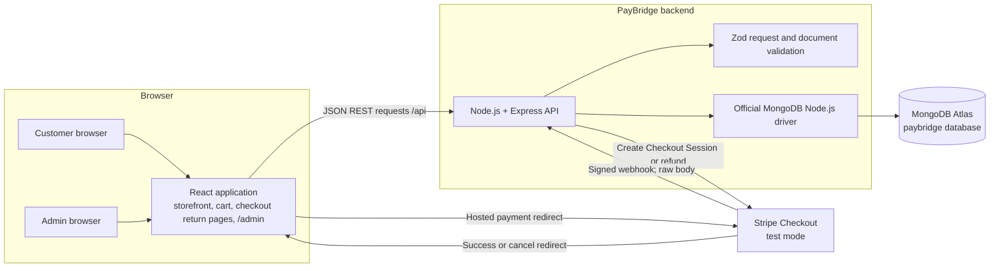
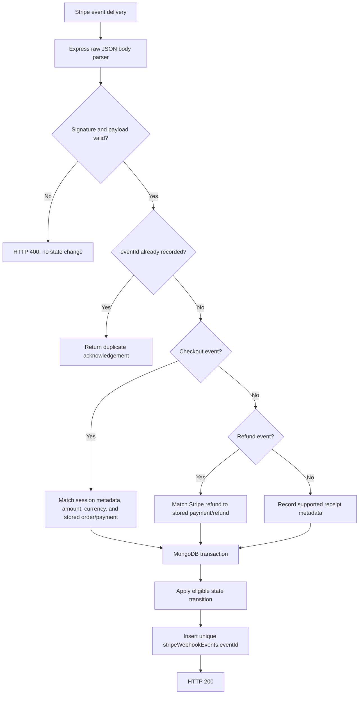
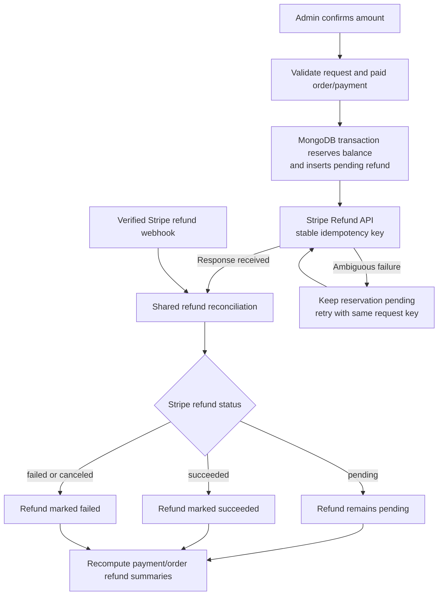

# PayBridge Architecture

## Purpose and scope

PayBridge is a single-merchant ecommerce portfolio application. The current implementation provides a React storefront, an Express API, a MongoDB database named `paybridge`, Stripe-hosted Checkout in test mode, signed Stripe webhook processing, and an authenticated admin dashboard with order, refund, and analytics views.

The backend is the source of truth for product availability checks, order prices, order/payment state, and refund balances. Stripe owns the payment collection experience and reports payment/refund outcomes. Browser return pages provide customer feedback; they do not confirm payment.

## System overview



In development, Vite proxies `/api` requests to the backend at `http://localhost:3001`. The deployment topology and production reverse-proxy configuration are not defined in this repository.

### Components and responsibilities

| Component | Responsibility |
|---|---|
| React storefront | Fetch active products, maintain a localStorage cart, collect customer name/email, submit product IDs and quantities, and show order confirmation. |
| React admin dashboard | Render overview, order/payment/webhook data, refund controls, and analytics. It sends a bearer token to protected admin APIs. |
| Express API | Validate requests, read/write the `paybridge` database, calculate order totals from current products, coordinate Stripe calls, verify webhook signatures, and serve admin data. |
| MongoDB Atlas | Persist product catalogue, immutable order-item snapshots, payment attempts, refund records, and processed webhook metadata. |
| Stripe | Host Checkout and execute payment/refund operations. Its signed events are reconciled into PayBridge state. |

The frontend selects `/admin`, `/checkout/success`, and `/checkout/cancelled` by pathname; other paths render the storefront. This is a small SPA route switch rather than a client-side routing framework.

### API boundaries

| API | Access and responsibility |
|---|---|
| `GET /api/health` | Public liveness/readiness check that pings MongoDB |
| `GET /api/products`, `GET /api/products/:id` | Public active catalogue reads |
| `POST /api/orders` | Public order creation from customer details, product IDs, and quantities |
| `POST /api/orders/:id/checkout` | Public request to create/reuse Checkout for a pending order |
| `POST /api/webhooks/stripe` | Stripe-only signed webhook endpoint; raw body required |
| `POST /api/admin/session` | Admin credential exchange for a signed bearer token |
| Other `/api/admin/*` routes | Bearer-token protected dashboard, order, payment, webhook metadata, refund, and analytics operations |

## Customer order and payment lifecycle

```mermaid
sequenceDiagram
  autonumber
  actor Customer
  participant UI as React storefront
  participant API as Express API
  participant DB as MongoDB: paybridge
  participant Stripe

  Customer->>UI: Browse catalogue / add cart items
  UI->>API: GET /api/products
  API->>DB: Find active products
  DB-->>API: Product documents
  API-->>UI: Product response

  Customer->>UI: Submit name, email, product IDs, quantities
  UI->>API: POST /api/orders
  API->>DB: Read current active product prices and stock
  DB-->>API: Product documents
  API->>API: Validate stock/currency; compute integer minor-unit totals
  API->>DB: Insert pending order with item snapshots
  API-->>UI: Order ID, reference, total, pending status

  Customer->>UI: Choose Pay with Stripe
  UI->>API: POST /api/orders/:id/checkout
  API->>DB: Read pending order and payment attempts
  API->>Stripe: Create/reuse hosted Checkout Session
  Stripe-->>API: Checkout Session ID and URL
  API->>DB: Upsert payment; store session ID on order
  API-->>UI: Checkout URL
  UI->>Stripe: Redirect to hosted Checkout
  Customer->>Stripe: Enter payment details
  Stripe-->>UI: Redirect to success or cancelled page
  Note over UI: Return page does not set paid status
  Stripe-->>API: Signed Checkout webhook
  API->>DB: Transactionally update payment/order and record event
```

The order endpoint accepts no client-supplied prices or totals. It loads current product documents, rejects inactive/unavailable products, verifies stock, rejects duplicate product IDs and mixed currencies, and calculates safe integer totals. It embeds each purchased product's name, image URL, unit price, quantity, line total, and currency in the order. The current implementation checks stock but does not decrement or reserve it.

Checkout reuses an existing open pending session where possible. Session creation uses a Stripe idempotency key based on the order ID and update time. The API persists the Checkout Session ID and a `payments` record after Stripe returns a session; if a later webhook arrives before the record is available, webhook processing can create the payment record from validated session metadata.

## Stripe webhook processing



`app.ts` mounts `express.raw()` on `/api/webhooks/stripe` before the general JSON parser. The router verifies the Stripe signature against the exact raw body. Processing and event insertion occur in a MongoDB transaction. A unique index on `eventId`, plus the initial duplicate lookup, makes event delivery idempotent.

Handled Checkout events include `checkout.session.completed`, asynchronous success/failure, and expiration. A successful verified payment updates the payment and order. A Checkout expiration marks the payment attempt cancelled, while the order remains pending so the customer can retry. A success-page redirect alone never marks an order paid.

The webhook archive stores event ID, event type, processing status, and receipt/processing timestamps; it does not store raw payloads or customer payment details. The admin event view therefore exposes metadata, not a full Stripe event body.

## Admin, refunds, and analytics

The frontend `/admin` route is not itself an authorization boundary. Admin APIs are protected by `requireAdmin`, except the login endpoint. The login endpoint checks configured credentials and issues an eight-hour HMAC-signed bearer token. The frontend keeps the token in session storage.

Refunds are initiated by `POST /api/admin/orders/:id/refunds`. The backend validates the payment/order relationship and current refundable balance inside a MongoDB transaction, reserves the amount in `pendingRefundAmount`, and writes an auditable record to `refunds`. It then calls Stripe using the associated PaymentIntent and a stable Stripe idempotency key. Stripe API responses and verified refund webhooks are reconciled through the same service; merely submitting a request does not imply a successful refund.

Refund outcomes are stored separately from the original paid order state:

- Refund records have `pending`, `succeeded`, or `failed` status.
- Payment/order summaries derive `none`, `pending`, `partially_refunded`, `fully_refunded`, or `failed`.
- Pending refunds reserve balance; succeeded refunds contribute to the refunded total; failed refunds release the reservation.



`GET /api/admin/analytics` validates optional UTC date, currency, order-status, and refund-status filters. MongoDB aggregation pipelines calculate order summaries, daily series, status counts, product revenue, and refund series. The orders pipeline uses `$match` and `$facet`; the refunds pipeline uses `$match`, `$lookup` to orders, and `$facet`. Amounts stay grouped by currency. Analytics counts payment success by distinct order status, not by payment attempt.

## MongoDB architecture

The backend uses one official MongoDB Node.js driver client and explicitly selects the `paybridge` database. Collection responsibilities, document shapes, relationships, and indexes are described in [DATA_MODEL.md](./DATA_MODEL.md).

Application schemas are validated with Zod at API boundaries and when reading persisted documents. MongoDB collection-level JSON Schema validators are not configured. Refund reservations and webhook state changes use multi-document transactions; product/order reads and ordinary order insertion do not.

## Known boundaries

- Product stock is checked during order creation but is not reserved or decremented. Concurrent orders can therefore pass the same stock check.
- Checkout Session creation and MongoDB writes span two systems and cannot share a transaction. Stripe idempotency and webhook-side payment upsert reduce, but do not eliminate, the operational complexity of partial failure.
- The webhook archive intentionally omits event payloads and correlation fields. It is not a full forensic event log, and recent generic Checkout events cannot always be attributed to an order.
- Admin authentication is a single configured account and an in-memory-verifiable signed token, with no user roles, server-side revocation, or multi-user identity system. It is appropriate only for a controlled portfolio demonstration.
- Analytics are computed on demand. The API applies indexes but has no default date window, materialized rollups, or analytics result pagination.
- Storefront price formatting divides integer amounts by 100. That matches the current cent-oriented catalogue, but other currency exponent rules would need explicit support to avoid display mismatches.
- The Overview success-rate metric counts terminal payment records; Analytics counts terminal order states. Multiple attempts for an order can make those two figures differ.
- The implementation is single-merchant and does not include customer accounts, shipping/tax calculation, inventory reservation, outbound merchant webhooks, or live Stripe payments.
