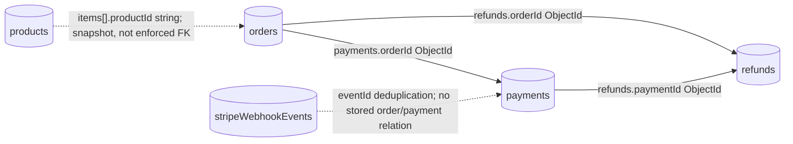

# PayBridge Data Model

## Database and validation

The backend connects with the official MongoDB Node.js driver and explicitly selects the `paybridge` database. Collections are created/indexed at backend startup. MongoDB-generated `_id` values are `ObjectId`s unless noted.

Zod schemas in the backend define application-level shapes for products, orders, payments, refunds, request payloads, and analytics filters/results. These schemas validate data at API boundaries and when selected documents are read. There are no MongoDB collection-level `$jsonSchema` validators, so writes made outside the application are not constrained by those Zod schemas.

All monetary fields are integer minor currency units. For the current USD catalogue, `1299` represents $12.99. The application rejects unsafe integer order arithmetic. Product and order currency fields use three-letter uppercase codes; the storefront currently formats amounts using a two-decimal assumption.

## Collections

### `products`

Catalogue documents validated by `ProductSchema`:

| Field | Meaning |
|---|---|
| `_id` | MongoDB product identity |
| `name`, `description` | Customer-facing catalogue content |
| `price` | Current unit price in integer minor units |
| `currency` | Three-letter uppercase currency code |
| `category` | Catalogue category |
| `imageUrl` | Public product image URL |
| `stock` | Current available quantity used by order validation |
| `active` | Controls whether product appears and can be ordered |
| `createdAt`, `updatedAt` | Lifecycle timestamps |

The public catalogue API reads only `active: true` documents and sorts by category/name. Orders do not store a live product-document reference as an enforced foreign key.

### `orders`

An order embeds a customer summary and an array of purchase snapshots:

| Field | Meaning |
|---|---|
| `_id` | Order identity used by API routes and related documents |
| `reference` | Human-facing `PB-...` reference; unique |
| `customer` | Embedded name and email |
| `items[]` | Embedded purchase-time snapshot: string `productId`, name, image URL, unit price, quantity, line total, and currency |
| `subtotal`, `total` | Integer minor units; current implementation has no separate tax or shipping charge |
| `currency` | Order currency; all order items must share it |
| `status` | `pending`, `paid`, `payment_failed`, or `cancelled` |
| `refundStatus`, `refundedAmount` | Denormalized refund summary maintained from refund records |
| `stripeCheckoutSessionId` | Optional latest/session reference |
| `createdAt`, `updatedAt` | Order timestamps |

Item `productId` values are stored as hexadecimal strings. The name/image/price snapshot preserves the purchase-time display and accounting values if the catalogue later changes. Product removal does not cascade into historical orders.

### `payments`

One record represents a Stripe Checkout payment attempt:

| Field | Meaning |
|---|---|
| `_id` | Payment record identity |
| `orderId` | `ObjectId` reference to `orders._id` |
| `orderReference` | Duplicated human-readable order reference for operations/reporting |
| `stripeCheckoutSessionId` | Stripe Checkout Session ID; unique |
| `stripePaymentIntentId` | Stripe PaymentIntent ID when available; otherwise nullable |
| `amount`, `currency` | Attempt amount in integer minor units and its currency |
| `status` | `pending`, `paid`, `payment_failed`, or `cancelled` |
| `provider` | Currently the literal `stripe` |
| `refundStatus`, `refundedAmount`, `pendingRefundAmount` | Denormalized refund totals and balance reservation |
| `createdAt`, `updatedAt` | Payment-attempt timestamps |

Payments are separate from orders because Checkout attempts have their own external identifiers and lifecycle; an order may have another attempt after an earlier session expires.

### `refunds`

Each partial or full refund is a separate audit record:

| Field | Meaning |
|---|---|
| `_id` | Internal refund identity |
| `stripeRefundId` | Stripe refund ID when known; unique sparse index |
| `idempotencyKey` | Unique application request key |
| `orderId`, `paymentId` | `ObjectId` references to the order and payment |
| `orderReference` | Human-readable association |
| `amount`, `currency` | Refund amount in integer minor units |
| `status` | `pending`, `succeeded`, or `failed` |
| `reason`, `failureReason` | Optional Stripe reason and outcome detail |
| `source` | `admin` or `stripe_webhook` |
| `createdAt`, `updatedAt` | Refund timestamps |

The records are the refund audit trail. Payment/order refund totals are updated summaries used by APIs and dashboards. The service reserves pending amounts transactionally and recomputes summary totals from refund records after Stripe responses or webhook events.

### `stripeWebhookEvents`

This collection records processed Stripe event metadata:

| Field | Meaning |
|---|---|
| `eventId` | Stripe event ID; unique and used for idempotency |
| `type` | Event type |
| `status` | Currently `processed` |
| `createdAt`, `processedAt` | PayBridge receipt/processing timestamps |

Raw webhook bodies and full event payloads are not retained. Failed processing attempts return an error to Stripe for retry but are not stored as event documents.

## Relationships

The order-item relationship to products is informational, not a MongoDB reference constraint. Payment and refund associations use `ObjectId` fields and application-level checks; MongoDB does not enforce foreign keys. Webhook events are deduplicated by Stripe event ID, while the event payload is inspected during processing to resolve the payment/order.

## Indexes

The backend calls `createIndexes()` during startup. The following indexes are configured:

| Collection | Index | Purpose |
|---|---|---|
| `products` | `{ active: 1, category: 1, name: 1 }` | Active catalogue filtering and sort |
| `products` | `{ createdAt: -1 }` | Created-date access pattern; no current public catalogue route depends on it |
| `orders` | `{ currency: 1, status: 1, createdAt: -1 }` | Currency/status/date analytics filters |
| `orders` | `{ createdAt: -1 }` | Recent orders and date sort |
| `orders` | `{ reference: 1 }` unique | Order-reference lookup and uniqueness |
| `orders` | `{ status: 1, createdAt: -1 }` | Status-filtered order listing |
| `orders` | `{ customer.email: 1, createdAt: -1 }` | Supports email equality/prefix access patterns; current unanchored case-insensitive admin search may not use it efficiently |
| `payments` | `{ createdAt: -1 }` | Recent payment listing |
| `payments` | `{ refundStatus: 1, updatedAt: -1 }` | Refund-state query access pattern |
| `payments` | `{ stripeCheckoutSessionId: 1 }` unique | Checkout Session lookup/upsert |
| `payments` | `{ orderId: 1, createdAt: -1 }` | Order-to-payment lookup |
| `payments` | `{ status: 1, updatedAt: -1 }` | Payment-state query access pattern |
| `stripeWebhookEvents` | `{ eventId: 1 }` unique | Webhook deduplication |
| `stripeWebhookEvents` | `{ createdAt: -1 }` | Recent event display |
| `refunds` | `{ idempotencyKey: 1 }` unique | Application refund-request idempotency |
| `refunds` | `{ stripeRefundId: 1 }` unique, sparse | Stripe refund reconciliation |
| `refunds` | `{ orderId: 1, createdAt: -1 }` | Order refund history |
| `refunds` | `{ paymentId: 1, createdAt: -1 }` | Payment refund totals/history |
| `refunds` | `{ currency: 1, status: 1, createdAt: -1 }` | Currency/status/date refund analytics |

The default `_id` indexes support lookup joins from refunds to orders. Indexes improve common equality filters and recent-list queries, but do not eliminate the cost of broad, unbounded analytics aggregations.

## Analytics aggregation shapes

`GET /api/admin/analytics` validates `from`, `to`, `currency`, `orderStatus`, and `refundStatus` before building pipelines:

1. The `orders` pipeline applies the order date/currency/status `$match`, then uses `$facet` branches for per-currency order and revenue totals, daily gross revenue, daily order counts by status, status distribution, and product revenue. Product revenue unwinds embedded order snapshots and groups by product ID/name/currency. It includes paid orders only.
2. The `refunds` pipeline filters by refund creation date and currency, looks up the associated order, and applies the order date/currency/status filters. Its summary facet includes succeeded refunds only and groups by currency/order before totaling; its time-series facet groups by UTC day, currency, and refund status. The refund-status filter narrows the time series, while settled refund KPIs continue to count succeeded records.
3. Gross revenue, succeeded refund totals, and net revenue remain separated by currency. Average order value is gross revenue divided by paid orders. Refund rate is distinct paid orders with a succeeded refund divided by paid orders. Analytics payment success rate is paid orders divided by paid plus payment-failed orders.
4. Aggregated monetary totals are checked for safe integer range, and the response is validated against a strict Zod schema.

The refund date range applies to both the refund's `createdAt` and its associated order's `createdAt`. Dates are interpreted as UTC calendar days.
