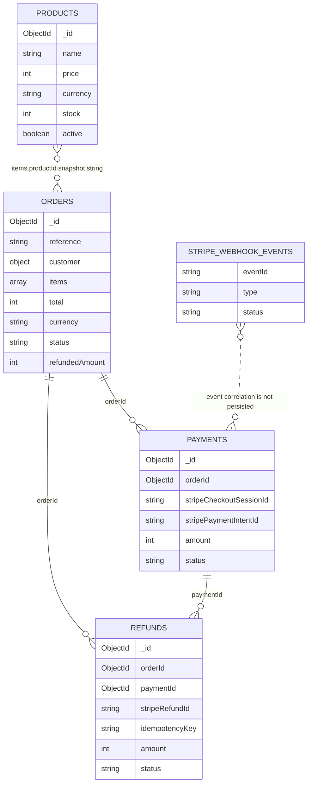

# PayBridge MongoDB Architecture

## Scope and database selection

PayBridge uses the official MongoDB Node.js driver and explicitly selects the `paybridge` database in `src/db.ts`. A module-level `MongoClient` is reused by the backend process/runtime; connection initialization is shared through a promise so concurrent first requests do not create concurrent connections. The URI supplies credentials and cluster details, not the database selection used by application operations.

The backend does not create indexes while handling requests. Index definitions are applied by the controlled `npm run db:indexes` command, which calls `createDatabaseIndexes()`. This separates schema/index setup from serverless cold starts and ordinary API traffic.

## Collections and responsibilities

| Collection | Responsibility |
|---|---|
| `products` | Current catalogue name, description, image, price, currency, stock, active flag, and timestamps. Public product reads filter to active records. |
| `orders` | Customer summary, unique human-readable reference, purchase-time item snapshots, integer minor-unit totals, order state, and denormalized refund summary. |
| `payments` | Stripe Checkout payment attempts and provider identifiers, associated order, amount/currency, payment state, refund totals, and timestamps. An order may have multiple attempts. |
| `refunds` | Auditable individual full or partial refunds, linked to an order and payment, with request/Stripe idempotency identifiers, amount, state, reason, source, and timestamps. |
| `stripeWebhookEvents` | Successfully processed Stripe event metadata (`eventId`, type, processed state, timestamps) used for duplicate detection and admin observability. Raw event payloads are not retained. |

### Relationships

`payments.orderId`, `refunds.orderId`, and `refunds.paymentId` are MongoDB `ObjectId` references. Code checks these associations when creating/reconciling refunds. MongoDB does not enforce foreign keys. `orders.items[].productId` is a hexadecimal string in an immutable purchase snapshot, not an enforced relationship. Webhook event documents do not persist a payment/order reference; event correlation is evaluated while processing the provider payload and is not retained for later lookup.

## Embedding versus referencing

Orders embed the customer name/email and item lines. Item lines snapshot product ID, name, image URL, unit price, quantity, line total, and currency. This keeps the order’s purchase-time facts together and prevents later catalogue edits from changing what an existing order says was purchased. The order-creation API accepts only product IDs and quantities; the backend reads current product values and computes the total.

Payments and refunds are separate documents because they have their own external identifiers and lifecycle. A pending order can have multiple payment attempts, and a payment can have multiple partial refunds. Separate refund documents preserve per-refund audit detail and support idempotency indexes without growing a nested refund-history array inside the payment document.

The trade-off is controlled duplication: order references and payment/order refund summaries repeat data that is also represented in related documents. Services reconcile those summary fields from the refund ledger. Reads are convenient for order snapshots and operational lookup, while consistency across documents requires application checks and transactions. Out-of-band writes can bypass those application guarantees.

## Index strategy

The exact index declarations live in `packages/backend/src/db.ts`; `npm run db:indexes` applies them to `paybridge`.

| Collection | Index | Kind | Intended access or integrity requirement |
|---|---|---|---|
| `products` | `{ active: 1, category: 1, name: 1 }` (`active_category_name`) | Compound | Active catalogue filtering and category/name ordering. |
| `products` | `{ createdAt: -1 }` (`created_at_desc`) | Single-field | Created-date access; current public product routes do not sort by this field. |
| `orders` | `{ currency: 1, status: 1, createdAt: -1 }` (`order_currency_status_created_at`) | Compound | Currency/status/date analytics filters. |
| `orders` | `{ createdAt: -1 }` (`order_created_at_desc`) | Single-field | Recent orders and date-sorted order lists. |
| `orders` | `{ reference: 1 }` (`order_reference_unique`) | Unique | Prevent duplicate human-readable order references and support reference lookup. |
| `orders` | `{ status: 1, createdAt: -1 }` (`order_status_created_at`) | Compound | Status-filtered order lists ordered by date. |
| `orders` | `{ customer.email: 1, createdAt: -1 }` (`order_customer_email_created_at`) | Compound | Email equality/prefix patterns; the current unanchored case-insensitive search may not efficiently use it. |
| `payments` | `{ createdAt: -1 }` (`payment_created_at_desc`) | Single-field | Recent payment listing. |
| `payments` | `{ refundStatus: 1, updatedAt: -1 }` (`payment_refund_status_updated_at`) | Compound | Refund-state and last-updated access pattern. |
| `payments` | `{ stripeCheckoutSessionId: 1 }` (`stripe_checkout_session_unique`) | Unique | Prevent duplicate local payment attempts for one Checkout Session and support event lookup/upsert. |
| `payments` | `{ orderId: 1, createdAt: -1 }` (`payment_order_created_at`) | Compound | Order-to-payment lookup and attempt ordering. |
| `payments` | `{ status: 1, updatedAt: -1 }` (`payment_status_updated_at`) | Compound | Payment-state query pattern. |
| `stripeWebhookEvents` | `{ eventId: 1 }` (`stripe_event_id_unique`) | Unique | Event delivery deduplication and concurrent duplicate protection. |
| `stripeWebhookEvents` | `{ createdAt: -1 }` (`stripe_event_created_at`) | Single-field | Recent processed event display. |
| `refunds` | `{ idempotencyKey: 1 }` (`refund_idempotency_unique`) | Unique | One stored refund request per client idempotency key. |
| `refunds` | `{ stripeRefundId: 1 }` (`stripe_refund_id_unique`) | Sparse unique | A non-null Stripe refund ID maps to at most one local refund; sparse permits records before Stripe assigns an ID. |
| `refunds` | `{ orderId: 1, createdAt: -1 }` (`refund_order_created_at`) | Compound | Refund history for an order. |
| `refunds` | `{ paymentId: 1, createdAt: -1 }` (`refund_payment_created_at`) | Compound | Refund history and totals for a payment. |
| `refunds` | `{ currency: 1, status: 1, createdAt: -1 }` (`refund_currency_status_created_at`) | Compound | Currency/status/date refund reporting. |

MongoDB's built-in `_id` indexes support object identity lookups and `$lookup` joins to `orders._id`. Index declarations express expected access and uniqueness needs; no query-plan or performance benchmark is claimed. Some analytics are broad, on-demand aggregations and are not guaranteed to be covered by indexes alone.

## Transactions, idempotency, and consistency

MongoDB transactions use `MongoClient.startSession()` and `session.withTransaction()`:

1. **Refund reservation:** the service checks the order, validates a paid payment belongs to that order, and checks the requested amount against the remaining refundable balance. It looks up the application request idempotency key and rejects reuse for different inputs. In one transaction it conditionally increments `payments.pendingRefundAmount`, inserts a pending `refunds` record, and marks the order refund summary pending. A conditional update also ensures the balance remains within the payment amount when concurrent requests race.
2. **Stripe call and reconciliation:** the Stripe API call occurs after the database reservation commits, so it is not part of the MongoDB transaction. The Stripe idempotency key is derived from the persisted refund document ID (`paybridge-refund-<refund ObjectId>`). The service reconciles the Stripe result in a MongoDB transaction and recomputes payment/order summary fields from refund documents. An ambiguous Stripe error keeps the reservation pending so a retry can reuse the same request key and Stripe idempotency key.
3. **Webhook processing:** the webhook service starts a MongoDB session, checks `stripeWebhookEvents.eventId`, applies supported Checkout or refund state updates, and inserts the processed event metadata within one transaction. Duplicate event delivery is handled by the lookup and unique event-ID index. A concurrent duplicate-key conflict is checked against the event record after the transaction error.

These are **MongoDB guarantees** for the database writes participating in each session transaction, assuming the configured MongoDB deployment supports transactions. They do not create a distributed transaction with Stripe. Stripe-side idempotency protects retrying a provider request with the same key; it does not commit MongoDB changes. Conversely, MongoDB's unique application idempotency key and refund transaction do not prevent Stripe duplication by themselves. The two mechanisms address distinct failure/retry boundaries.

Order creation and Checkout Session creation are not one transaction with Stripe. Checkout uses a Stripe idempotency key derived from the order ID and order update timestamp and reuses an open pending session where possible. Webhooks reconcile outcomes. These measures mitigate retries but do not provide cross-system atomic commit.

## Aggregation pipelines and analytics

Admin analytics are calculated on demand in `packages/backend/src/admin/analytics.service.ts`; results are not precomputed or materialized.

- **`$match`:** applies date, currency, order-status, refund-status, and paid-order filters before grouped analytics. UTC date ranges include the requested end date.
- **`$facet`:** splits a matched order stream into summary, daily revenue, daily order status counts, status distribution, and product revenue outputs in one order aggregation. Refunds similarly branch into settled summary and time-series output.
- **`$group`:** calculates per-currency totals, daily series, status counts, per-product revenue/quantity, and refund totals. Paid orders alone contribute gross revenue; refunds are totaled only when succeeded for settled refund metrics. Currency is part of monetary grouping.
- **`$unwind`:** expands embedded order item snapshots to attribute paid line totals and quantities to products.
- **`$lookup`:** joins refund records to their order so analytics can apply associated-order date, currency, and status filters.

The resulting metrics include total/paid/pending/failed orders, gross revenue, succeeded refunds, net revenue, average order value, refund rate, and payment success rate. Revenue/refund amounts remain grouped by currency. Analytics payment success rate uses terminal order statuses (`paid` and `payment_failed`), whereas the Overview metric uses terminal payment records; multiple payment attempts can make them differ. The `refundStatus` filter applies to the refund time series; settled summary totals continue to count succeeded refunds.

## Validation and integrity boundaries

Zod validates public order-creation and product data, refund requests, admin filters, and many stored documents when read or serialized. API validation includes strict request objects for order creation, refund creation, admin login, and analytics filters. Business checks validate product activity/stock, currency consistency, payment/order association, and refundable balance.

MongoDB collection-level JSON Schema validators are **not configured**. There are also no MongoDB foreign keys or cascading deletes. Writes performed outside the application can violate Zod-defined shapes or leave references and denormalized summaries inconsistent.

## Trade-offs and limitations

- Product stock is checked but not decremented or reserved; concurrent order creation can pass the same stock check.
- Item product IDs are snapshot strings and are not enforced references.
- Payment/order/refund consistency depends on application code and transaction-capable MongoDB deployment.
- Checkout and refund provider calls remain cross-system workflows; neither can be made atomic with MongoDB transactions.
- Only successfully processed webhook metadata is persisted. Raw payloads and failed attempts are not retained, and event-to-order correlation is unavailable from stored event documents.
- Analytics are on-demand, without a default date window, materialized rollups, or pagination. No large-scale throughput claim is made.
- Admin access is one configured identity with signed bearer tokens, not a multi-user role/identity system.
- Product and order monetary amounts use integer minor units, but storefront display currently assumes two fractional digits.

See also [system architecture](./ARCHITECTURE.md), [collection data model](./DATA_MODEL.md), and [technical decisions](./TECHNICAL_DECISIONS.md).
